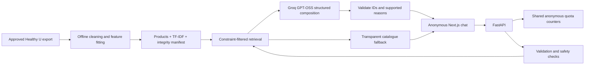

# RetailAssist — Healthy U conversational recommendations

DSA 8401 Applied Machine Learning · MSc Data Science & Analytics · Admission 109419.

**Final audit (20 November 2026): READY WITH LIMITATIONS.** The existing public [chat application](https://retail-assistant-tau.vercel.app/) and [API](https://retail-assist-api.vercel.app/health) are working after an explicitly authorized repair. Both production projects run verified source `7d46aea`. API readiness reports 5,512 records; five controlled public chat cases passed, including two actual Groq generations. The live browser rendered grounded product references and KES prices. See [final handoff](reports/final/FINAL_HANDOFF.md) and [before/after evidence](reports/final/production/PRODUCTION_VERIFICATION.md). Human-labelled retrieval-quality evaluation and optional semantic experiments remain outstanding.

## Problem and objectives

A shopper should be able to describe a product interest and KES budget, compare real catalogue matches and narrow a conversation without scanning a storefront. The project combines fitted retrieval, hard constraints and controlled language generation. Objectives are reproducible data preparation; factual recommendations with traceable product IDs; explicit handling of unknown attributes; and a safe anonymous chat service.

## Data and provenance

The user approved the existing Healthy U product export for this public presentation MVP and confirmed RRP currency as KES. Executed ingestion retained **5,512 records**, rejected zero, and fitted **12,000 TF-IDF features**. The source SHA-256, normalization details and artifact checksums are in `apps/api/catalogue/manifest.json` and [evaluation evidence](reports/final/evaluation/). Compact allowlisted inference artifacts accompany the application; the raw enclosing HU export and all customer/order records are excluded.

The snapshot has no verified current stock, structured ingredients, dietary labels or snapshot date. No ingredient suitability, clinical efficacy or availability claims may be inferred from marketing text. Current prices must be confirmed with the retailer. The source HU application is unchanged.

## Architecture



Both services have multi-stage production containers and Vercel Container configurations. Training/index fitting stays offline. No auth, account database, cart, checkout or product-browsing interface is included. Redis stores expiring anonymous quota counters only; browser session storage retains recent chat locally. Requests submitted to Groq may leave the device as explained in the app.

## Machine learning methodology

The deployed source supports a genuine fitted TF-IDF baseline: cleaned text, tokenization, learned IDF, normalized sparse product vectors and query ranking. Budgets and supported metadata constraints filter candidates; unknown attributes fail required constraints. Offline optional MiniLM teacher embeddings, PCA and a ridge query projection plus reciprocal rank fusion are implemented but **not fitted/evaluated for this final audit**. It is an approximate projected query encoder, not a transformer query model running online.

Groq uses environment-selected `openai/gpt-oss-120b` through its compatible HTTP API. GPT-OSS is neither trained nor fine-tuned here. Generation chooses catalogue IDs and record-specific supported explanations; fabricated IDs/unsupported reasons fail validation. Missing key, quota exhaustion or provider errors return labelled factual fallbacks. Medical questions bypass recommendations. Public requests fail closed without shared rate limiting.

## Actual verification and evaluation

- 23 backend tests passed after the urgent visual-symptom regression fix; Ruff passed.
- Frontend Node 22 type-check, lint and production build passed after the navigation fix. Backend, frontend and Docker GitHub Actions all passed at source 7d46aea.
- Both Docker images built; disposable-container probes verified health, readiness and fallback. See current audit for build revision scope.
- Local ASGI requests with real data made **two successful Groq generations**. Suitability clarification, urgent safety and no-match abstention were also observed. Post-release public checks separately established two successful Groq generations and correct clarification/safety/no-match modes.
- 260 warm local retrieval diagnostics across 13 scripted cases: mean 1.332 ms, p95 2.528 ms. 640 returned reference occurrences had zero invalid IDs or evaluated hard-constraint violations; five expected abstention scenarios passed. These diagnostics are not relevance accuracy or general safety estimates.
- Precision@K, Recall@K, MRR and NDCG are **BLOCKED** until a defensible human-reviewed Healthy U relevance set exists. No comparative semantic/hybrid accuracy is claimed.

Read [evaluation summary](reports/final/evaluation/EVALUATION_SUMMARY.md), raw JSON/CSV and measured plots. Legacy Flipkart results are not Healthy U evidence.

## Reproduce locally

Python 3.12, Node 22 and Docker Desktop/Compose v2 are required. See [QUICKSTART](QUICKSTART.md), [container runbook](CONTAINERS.md) and [deployment instructions](VERCEL_DEPLOYMENT.md).

```bash
python3.12 -m venv .venv-mvp
source .venv-mvp/bin/activate
pip install -r apps/api/requirements-dev.txt
python scripts/mvp/manage.py env --execute
# Supply approved original export at this local path; it is not a public raw-data download.
python scripts/mvp/prepare.py ingest --source ../rag_pipeline/data/Enhanced_Product_List.json --currency KES --approved
python scripts/mvp/prepare.py index
(cd apps/web && npm ci)
(cd apps/api && ../../.venv-mvp/bin/python -m pytest -q)
python scripts/mvp/audit_offline.py
# Edit private local backend key/settings before starting; no key belongs in source.
docker compose up --build -d
```

Open http://localhost:3000; API port 8001. `/health` is liveness; `/ready` checks prepared catalogue and configured controls. Frontend `/api/runtime-config` exposes the public API origin only. POST `/api/chat` and `/api/recommend` accept message/history/preferences/k; GET `/api/system-info` reports actual catalogue and retrieval mode. `/docs` and `/openapi.json` document the API.

The authorized production repair set API_BASE_URL on the web project, exact ALLOWED_ORIGINS on the API and a private rate-limit salt alongside existing shared Redis settings. Both projects were rebuilt/promoted from 7d46aea without merging or rewriting main. Preserve these settings and PORT=8080 for future approved releases.

## Academic submission and repository map

- [Compliance evidence](PROJECT_COMPLIANCE.md)
- [Final report source](reports/final/RETAILASSIST_FINAL_REPORT.md) and report PDF when generated
- [Presentation content](reports/final/PRESENTATION.md)
- [AI assistance disclosure](AI_USE.md)
- `apps/api`, `apps/web`: current implementation and containers
- `scripts/mvp`, `research/mvp`: reproducible preparation, evaluation and notebook
- `reports/final`: current audit, measured evidence and academic deliverables
- `.github/workflows/mvp-*.yml`: validation and guarded manual production deployment

## Limitations and future work

The public application passed the recorded smoke checks; continued provider quota and snapshot freshness remain operational limitations. Human relevance annotation and semantic/hybrid comparisons remain outstanding. The diagnostic suite is small, warm-process and not representative of production network latency; conservative regex safety is not clinical validation. Obtain maintained manufacturer ingredient/allergen metadata and current stock, broaden independently reviewed evaluations, and test multilingual/accessibility behaviour before expanding scope.

## Historical material

`src/retailassist`, `web`, `artifacts`, old notebooks and older top-level report results are retained as explicitly **legacy Flipkart/SmolLM experiments**. They are excluded from the two app build contexts. `docker-compose.legacy.yml` preserves the previous stack; root Compose is canonical and `docker-compose.mvp.yml` is a compatibility copy. No historical results are reused as Healthy U metrics. See [cleanup inventory](reports/final/REPOSITORY_CLEANUP.md).
