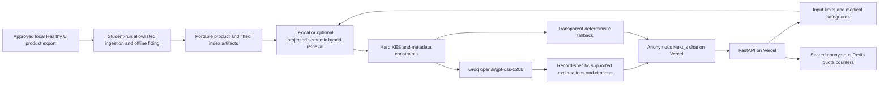

> Container architecture update: both app images and the root two-service Compose stack are now defined. Use [CONTAINERS.md](CONTAINERS.md) locally and [VERCEL_DEPLOYMENT.md](VERCEL_DEPLOYMENT.md) for the current Container-runtime deployment instructions, which supersede earlier native-framework hosting steps below. Builds and deployments remain unexecuted.

# RetailAssist — Healthy U / Groq chat MVP

An anonymous, chat-first retail recommender for the DSA 8401 presentation. New implementation roots: **apps/web** (Next.js) and **apps/api** (FastAPI), deployed as **two Vercel projects from the existing afrochic/RetailAssistant repository**.

**Status: source/configuration implemented; ingestion, fitting, tests, builds and deployment are PENDING USER EXECUTION. No live MVP URL or new evaluation result is claimed.**

Start with [QUICKSTART.md](QUICKSTART.md), then [VERCEL_DEPLOYMENT.md](VERCEL_DEPLOYMENT.md). [MANUAL_RUNBOOK.md](MANUAL_RUNBOOK.md) gives the full command order. [BLOCKERS.md](BLOCKERS.md) distinguishes missing configuration from unexecuted work.

## Architecture

## Product scope

No login, registration, accounts, user database, catalogue browsing, cart or checkout. Session-local chat, new conversation, examples, Markdown text, loading/errors/retry, KES preferences and traceable recommendation references. This is an independent student project, not an official Healthy U service or medical practitioner.

Real source located in the enclosing HU workspace: `rag_pipeline/data/Enhanced_Product_List.json`, 5,512 existing records. User confirmed presentation-use approval and KES RRP. The export lacks current stock, structured ingredients/brands/verified dietary labels and export date. The source application is unchanged. Run manual ingestion before claiming an accepted catalogue count. No Flipkart substitutions or test fixtures populate the MVP.

## Inference and Groq

- Genuine fitted TF-IDF baseline, serialized as JSON; no training or model download during requests.
- Optional offline MiniLM teacher embeddings and fitted lightweight query projection with RRF. This is an **approximate projected query encoder**, not native transformer encoding at request time. Default MVP is honestly labelled lexical until semantic artifacts are manually built.
- Server-only `GROQ_API_KEY`, environment-selected `GROQ_MODEL=openai/gpt-oss-120b`, supported compatible HTTP endpoint and strict structured output.
- Groq composes answers from approved record IDs and supported, fact-checked explanation choices. This intentionally restricts free-form product/medical claims. No 120B checkpoint runs on Vercel.
- Missing key, 429/quota, timeout, provider errors and failed grounding produce labelled catalogue-fact fallbacks. No automatic provider retries in the MVP. Explicit user retry is available.
- Public requests require shared ephemeral Redis rate/quota controls. This is not a customer/account/chat database. If shared controls are missing or fail, public requests fail closed.

## Entry points and deliverables

- `apps/api/app.py`: /health, /ready, /api/chat, /api/recommend, /api/system-info, /docs.
- `apps/api/retail_mvp`: retrieval, strict schemas, source provenance, safety, Groq and quota controls.
- `apps/web`: Next.js 16 / React / TypeScript / Tailwind, Node 22.
- `scripts/mvp/prepare.py`: manual approved export and lexical/optional semantic fitting.
- `scripts/mvp/manage.py`: dry-run-first local/server/test/build/Docker/smoke/deploy commands.
- `scripts/mvp/evaluate.py`: refuses unreviewed labels; produces actual retrieval/generation evidence when executed by the student.
- `research/mvp`: unexecuted query template, notebook, academic report draft and slide outline.
- `reports/mvp`: read-only audit, source review and execution-status record.
- `apps/api/Dockerfile`, `docker-compose.mvp.yml`: academic local reproduction; not the Vercel hosting mechanism.
- `.github/workflows/mvp-*.yml`: manual validation and guarded deployment scaffolding, not automatically executed.

## Historical implementation

The older `src/retailassist`, `web`, `artifacts`, `notebooks` and `reports/RetailAssist_Report.pdf` belong to the previous Flipkart/SmolLM implementation. Their measured scores and deployment checks **are not Healthy U/Groq evidence**. Old instructions are preserved in `docs/LEGACY_FLIPKART_*`. New Vercel roots exclude those heavyweight assets. Do not run old root commands for this MVP.

Read [AI_USE.md](AI_USE.md), [DATA_CARD.md](DATA_CARD.md) and [PROJECT_COMPLIANCE.md](PROJECT_COMPLIANCE.md) before submission. Preserve the repository's history and execute Git operations yourself after reviewing the changed files.
