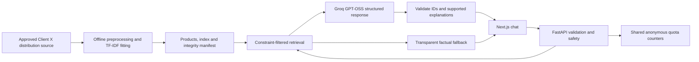

# RetailAssist — Client X conversational recommendations

**DSA 8401 · Applied Machine Learning · MSc Data Science & Analytics · Admission 109419**

Start with **[SUBMISSION_GUIDE.md](SUBMISSION_GUIDE.md)** for direct links to every assessed deliverable. The **[final report is one page](reports/final/RETAILASSIST_FINAL_REPORT.pdf)**; [editable report source](reports/final/RETAILASSIST_FINAL_REPORT.md) and [12-slide presentation content](reports/final/PRESENTATION.md) are included.

## Problem and objectives

RetailAssist accepts a natural-language product interest and KES budget, retrieves actual catalogue records and provides grounded explanations. Follow-up requests maintain preferences. The research objectives are reproducible retrieval, hard-constraint compliance, traceable source records and transparent refusal when evidence is missing. It is an anonymous chat application, without authentication, accounts, a storefront, cart or checkout.

## Data and privacy

Client X is the pseudonym for the approving retail client. The [distributable source](data/client_x_catalogue.json) contains **5,512 approved product records**: ID, SKU, name, description, categories and RRP in KES. It excludes customer/order information, retailer URLs and the client's name. Text was converted to plain text and configured client aliases were redacted from the private export. The private original is unchanged and is not required to run the published pipeline. See [DATA_CARD.md](DATA_CARD.md).

Product names and IDs remain source records; client-name redaction is not a guarantee against reidentification using external catalogues. Ingredients, verified dietary labels, current stock and snapshot date are unavailable. Unknown fields fail required constraints instead of being guessed. Earlier Git revisions, external CI history and the previously deployed application are outside this current-snapshot cleanup; no history rewrite or new deployment has been performed.

## Architecture



## Machine learning approach

The fitted baseline learns vocabulary and IDF from product text, stores normalized sparse vectors and ranks query matches. Parsed budgets are filters rather than relevance terms. Groq's environment-selected `openai/gpt-oss-120b` composes structured responses from the retrieved records; it was **not trained or fine-tuned here**. Invalid identifiers, unsupported reasons, quota failures and provider errors trigger labelled factual fallback.

Optional offline MiniLM teacher embeddings, PCA, a lightweight query projection and reciprocal rank fusion are implemented but not fitted/evaluated in this submission. No native query transformer runs in production. Collaborative/supervised ranking is excluded because interaction data and reviewed relevance labels are absent. See the [methodology](docs/METHODOLOGY.md) and [evaluation summary](reports/final/evaluation/EVALUATION_SUMMARY.md).

## Current verification and limits

The name-redacted source was ingested and refitted; all 5,512 records were retained with 12,000 features. Current local tests and build evidence are in [cleanup validation](reports/final/CLEANUP_VALIDATION.md). Current warm retrieval diagnostics measured 260 calls: mean **1.134 ms**, p95 **2.265 ms**, with no invalid IDs or exercised hard-constraint violations. These are software diagnostics, not relevance accuracy.

Historical backend, frontend and Docker CI passed at source `7d46aea`; five historical public acceptance cases passed, including two actual Groq generations. Original identifying screenshots/raw payloads have been withdrawn from the current snapshot. The Client X changes require their own reviewed release before they appear publicly. **Precision@K, Recall@K, MRR and NDCG remain blocked by missing independently reviewed labels.**

## Run from a clean checkout

Requires Python 3.12, Node.js 22 and Docker/Compose v2. No private original dataset is needed.

```bash
python3.12 -m venv .venv-mvp
source .venv-mvp/bin/activate
pip install -r requirements-dev.txt
python scripts/mvp/manage.py env --execute
python scripts/mvp/prepare.py ingest --source data/client_x_catalogue.json --currency KES --approved
python scripts/mvp/prepare.py index
python -m pytest -q
(cd apps/web && npm ci && npm run build)
python scripts/mvp/audit_offline.py
docker compose up --build -d
```

Keep credentials only in ignored `apps/api/.env`. Groq is optional locally; absent/failed credentials yield an explicit fallback. Frontend http://localhost:3000; API http://localhost:8001. Public deployments require shared Redis rate limits, a private salt and exact CORS configuration. See [QUICKSTART.md](QUICKSTART.md), [CONTAINERS.md](CONTAINERS.md) and [VERCEL_DEPLOYMENT.md](VERCEL_DEPLOYMENT.md).

## API and containers

`apps/api/app.py` exposes GET `/health`, `/ready`, `/api/system-info`, `/openapi.json`, and POST `/api/chat` plus `/api/recommend`. Requests contain message/history/preferences/k. Citations use `CX:` product IDs. Public distribution records have `url=null`; no identifying retailer links are displayed. Any future private source-link configuration requires an explicit backend host allowlist.

Both app roots contain multi-stage `Dockerfile` and `Dockerfile.vercel` files. Root `Dockerfile` builds the current API from the repository root; root `docker-compose.yml` builds both apps. Next.js uses standalone output, non-root containers listen on PORT=8080, and ML fitting remains offline.

## Repository map

| Directory/file | Purpose |
| --- | --- |
| [SUBMISSION_GUIDE.md](SUBMISSION_GUIDE.md) | Seven-item examiner navigation |
| [AI_USE.md](AI_USE.md) | Student-provided disclosure, preserved exactly |
| `apps/api/`, `apps/web/` | Current FastAPI and Next.js apps |
| `data/client_x_catalogue.json` | Approved name-redacted reproduction source |
| `scripts/mvp/` | Export, ingestion, fitting, evaluation and manual operations |
| `research/mvp/` | Current notebook and honest relevance-label template |
| `reports/final/` | One-page report, slides, current measurements and audits |
| `docs/` | Methods, architecture decisions and privacy notes |
| `legacy/flipkart/`, `legacy/planning/` | Clearly separated historical experiments/planning |

Older experiments and their scores are not Client X results. Read [PROJECT_COMPLIANCE.md](PROJECT_COMPLIANCE.md) for evidence, limitations and status rather than equating file existence with completed research.
