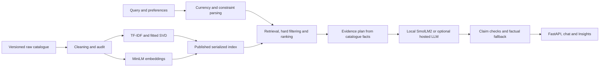

# RetailAssist

DSA 8401 Applied Machine Learning capstone, admission 109419. An end-to-end conversational product recommendation system: semantic retrieval, hard preferences, actual grounded LLM explanations, evaluation, FastAPI, Docker, a shopping interface and an Insights dashboard.

## Architecture



## Quick start from the public repository: no retraining

Use Python 3.9, matching the verified runtime. First setup needs internet access, several minutes and a few GB of free disk. No paid API key is required for local generation.

```bash
git clone https://github.com/afrochic/AML_project.git
cd AML_project
python3.9 -m venv .venv
source .venv/bin/activate
pip install -r requirements-dev.txt
pip install -e . --no-deps
python -m retailassist.bootstrap --with-generator
uvicorn retailassist.api:app --host 127.0.0.1 --port 8000
```

Open http://localhost:8000 and /docs. `bootstrap` checks the source SHA-256 and exact product-ID order, then binds the downloaded catalogue to the **published trained index and encoder**. It does not fit SVD, recompute TF-IDF or embed products. The local generator is downloaded from its pinned Apache-2.0 Hugging Face revision. It is too large for a normal GitHub file and is restored automatically by the documented command.

Original scraped records remain outside Git because the dataset mirror's license is unknown. Published `artifacts/retriever_index.joblib` contains trained vectors/parameters and ordered IDs, not original product descriptions. `artifacts/encoder/` contains the licensed MiniLM checkpoint. See `artifacts/ARTIFACTS.md`. Never load an untrusted joblib file.

## Rebuild and reproduce every stage

```bash
python -m retailassist.pipeline
python -m retailassist.evaluate
python -m retailassist.evaluate_generation
pytest -q
python scripts/execute_notebook.py
python scripts/build_deliverables.py
```

The pipeline downloads the pinned raw catalogue, audits/cleans records, fits TF-IDF and SVD, computes MiniLM embeddings and serializes all artifacts. Seed 42 and the source/model revisions are recorded. `--no-semantic` is available for low-resource TF-IDF/SVD experiments. The frontend detects absent semantic embeddings and uses keyword search.

Notebook: `notebooks/RetailAssist_walkthrough.ipynb`. Report: `reports/RetailAssist_Report.pdf`. `PROJECT_COMPLIANCE.md` maps the brief and proposal to implementation and verification. Direct dependencies are pinned; `requirements-lock.txt` records the executed macOS environment and is not a cross-platform Linux lockfile.

## Actual grounded LLM explanations

The AI assistant uses MiniLM hybrid retrieval, then a **local SmolLM2-135M-Instruct LLM** to verbalize an evidence plan constructed only from retrieved prices, categories, availability and accepted constraints. The model generates text, not merely product IDs. Product identities remain attached by application code. Numeric, unsupported-word, stock and suitability checks reject questionable generated prose, falling back to explicit catalogue facts. These checks are conservative heuristics, not proof of entailment or human-verified factuality.

The frozen test set was run through the actual local LLM: **24 outputs, 7 accepted and 17 flagged/fallback responses**. All 24 served results satisfied the benchmark price/category constraints. Raw outputs, served text and individual flags are in `reports/generation_evaluation.json`; the summary is also shown in Insights. The high fallback rate is an honest limitation of this small model and its strict checks, not an accuracy claim. Human review remains necessary. No hosted paid API evaluation is claimed.

The assistant supports budget-only follow-ups to the last product intent and carries confirmed UI filters. This is limited client-side conversational context, not a general dialogue agent. Category and rating filters are explicit; the parser handles common budget expressions and brands introduced by by/from/brand. Complex negation or inferred technical suitability is not guaranteed.

Optional hosted generation: set `OPENAI_API_KEY` securely, optionally `OPENAI_MODEL`, and send `use_llm: true, generation_provider: openai`. The provider uses structured explanations with catalogue product citations and the same claim checks. Do not put keys in Git or notebook cells. Queries and retrieved catalogue fields are sent externally only when this provider is selected.

## INR and estimated KES

Original prices remain INR. Select **KES estimate** to convert using the dated Kenya Revenue Authority reference **1 INR = 1.37 KES**, valid 16–22 November 2026. This is a reference conversion of historical Indian prices, **not Kenyan inventory, a live exchange quote or a current Kenyan retail offer**. Source INR values and conversion provenance remain in each product response. Hard budget filters operate in the selected currency, with Decimal rounding. Mixed/contradictory currencies and unsupported USD/EUR are rejected.

Source: https://www.kra.go.ke/images/foreignexchange/EXCHANGE-RATE-RUNNING-FROM-16th-November-2026-to-22nd-November-2026.pdf . Refresh the documented reference before claiming current estimates beyond that period.

```bash
curl -X POST http://localhost:8000/recommend \
 -H 'Content-Type: application/json' \
 -d '{"query":"running shoes under KSh 2000","currency":"KES","method":"hybrid","use_llm":true,"generation_provider":"local","constraints":{"category":"Footwear"}}'
```

## API and interface

- `/recommend`: constrained retrieval, optional actual LLM generation and transparent fallback status.
- `/catalogue`, `/discover`, `/products/{id}`: catalogue metadata and original product details, with INR/KES display options.
- `/insights`: actual catalogue statistics, retrieval metrics and local generation evaluation.
- `/health`: readiness and semantic availability; `/docs`: OpenAPI explorer.

The frontend includes category browsing, budget/rating filters, sorting, original listing photos, details, browser-local shortlists and AI chat. Editorial collection photos are inspiration; missing listing photos have a labelled fallback. There is no checkout or account. No sales, conversion or customer-usage figures are invented. Fonts and editorial photography are bundled with attribution/licenses.

## Docker

After `bootstrap --with-generator`:

```bash
docker compose up --build -d
python scripts/smoke_test.py
curl http://localhost:8000/health
docker compose down
```

A clean clone can also build the image: the Dockerfile restores catalogue records around public indexes when the serving bundle is absent. For offline local LLM operation, run setup with `--with-generator` before building. The non-root service is mapped only to 127.0.0.1:8000. This is verified local deployment, not public cloud hosting. Public deployment would require appropriate TLS, authentication and rate limits. Keys are excluded from the build context.

## Evaluation and limitations

The 20,000-row historical Flipkart sample yields 19,920 usable records. Prices and stock are not current; 18,081 usable products lack numeric ratings. There are no reliable user interactions, purchases or demographic labels.

Four methods are evaluated: TF-IDF, SVD/LSA, MiniLM and fixed 75% semantic / 25% lexical hybrid. Thirty AI-authored queries have rule-based silver judgments: six development and 24 test. Report Precision@5, Recall@5, MRR@5 and NDCG@5, with query-bootstrap intervals. Hybrid test NDCG@5 is approximately 0.813; this small weak-label benchmark does not establish real shopper satisfaction. Latency includes cold starts. See per-query results and DATA_CARD.md.

GitHub Actions pins Ubuntu 22.04/Python 3.9, installs CPU PyTorch, runs tests, restores artifacts from the original source and exercises the restored KES API. This directly tests the public-repository reproduction path. Browser visual/interaction QA remains blocked by a saved authoring-session permission setting; HTTP/API and code checks are recorded separately.

Read AI_USE.md and the course individual-work policy before submitting or claiming authorship.
