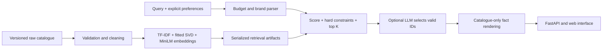

# RetailAssist

DSA 8401 Applied Machine Learning capstone, admission number 109419. A scripted, constraint-aware product retrieval service with a Jupyter walkthrough, optional guarded LLM reranking, API, web interface, Docker deployment and detailed report.

## Architecture



## Reproduce from scratch

Use Python 3.9 (Docker pins the same major/minor version). Network access is required for initial dependencies, source catalogue and pinned encoder download. Allow several minutes for CPU embeddings and roughly 1 GB disk including model caches.

```bash
python3.9 -m venv .venv
source .venv/bin/activate
pip install -r requirements-dev.txt
pip install -e . --no-deps
python -m retailassist.pipeline
python -m retailassist.evaluate
pytest -q
python scripts/build_deliverables.py
uvicorn retailassist.api:app --host 127.0.0.1 --port 8000
```

Visit http://127.0.0.1:8000 for the redesigned shopping interface, AI assistant and Insights dashboard and /docs for the API explorer. Notebook: `notebooks/RetailAssist_walkthrough.ipynb`. PDF: `reports/RetailAssist_Report.pdf`. Notebook cells call the same tested pipeline modules instead of duplicating an alternative implementation. Full raw-to-model rebuild is the CLI pipeline above. Notebook execution is optional using `python scripts/execute_notebook.py`.

Low-resource alternative: `python -m retailassist.pipeline --no-semantic` builds TF-IDF and SVD only. Select `method: tfidf` or `lsa` in API requests; the UI defaults to hybrid, which requires the semantic build. Do not call SVD a pretrained transformer or a fine-tuned LLM.

## API example

```bash
curl -X POST http://127.0.0.1:8000/recommend \
 -H 'Content-Type: application/json' \
 -d '{"query":"running shoes under INR 1500","k":5,"method":"hybrid","constraints":{"category":"Footwear"}}'
```

The client should carry confirmed preferences in `constraints` on subsequent turns. This is a stateless conversational-style search interface, not an autonomous dialogue agent. Regex parses common upper/lower budget and brand mentions introduced by by/from/brand. Category, rating and availability constraints can be supplied explicitly. Complex negation, multiple budgets and implied suitability need clarification by a human/client. Budget is a hard ceiling, not a guessed currency conversion. KES/USD queries are rejected.

Optional LLM: set `OPENAI_API_KEY`, optionally `OPENAI_MODEL`, and send `use_llm: true`. The LLM can select/reorder retrieved product IDs only. Invalid IDs, duplicate IDs, malformed responses and network failures fall back to deterministic results. All factual prose is rendered from catalogue records. This deliberately constrains generation; no free-form claim about gaming performance or medical suitability is allowed. Initial evaluation does not call the paid LLM or measure its quality.

## Docker

Build model artifacts first, then:

```bash
docker compose up --build -d
curl http://localhost:8000/health
docker compose logs --tail=50
docker compose down
```

Container exposes port 8000, mapped only to localhost by Compose. Run behind TLS/auth/rate limiting before any public deployment. No cloud deployment or spending is performed. Build is CPU-oriented and downloads dependencies. Encoder files generated locally are copied into the image; model cache is excluded. Do not send keys into a Docker build context; `.env` is excluded. A daemon must be running. Container build/run status is recorded in `reports/verification.json`.

## Evaluation and interpretation

30 silver-label queries, including six development and 24 test queries; see DATA_CARD.md. Frozen weights: 75% normalized semantic similarity + 25% TF-IDF cosine; no test tuning. Report P@5, R@5, MRR@5, NDCG@5 and bootstrap NDCG intervals. Zero-judgment queries are counted and excluded from summary means. Full qrels and per-query results are saved. Empty results count as zero on queries with positive labels. Macro recall is low for broad categories with many relevant products; do not confuse it with a bug. Latency includes cold model load on the first semantic call and is not a production benchmark.

`reports/data_audit.json` documents real missingness. No synthetic corruption is represented as real data. No interactions means collaborative filtering, purchase conversion and personalized rankings cannot be evaluated. Reviews/ratings are not relevance labels.

## Repository and artifacts

- `src/retailassist/`: ingestion, cleaning, index fitting, inference, service and evaluation.
- `tests/`: constraint, API, metric and LLM validation checks with isolated fixtures.
- `data/queries.json`, `data/qrels_silver.json`: benchmark and explicit labels.
- `artifacts/fitted_transformers.joblib`: fitted TF-IDF and SVD training artifacts included in Git.
- `artifacts/manifest.json`: data SHA-256, model revision and seed.
- `artifacts/retriever.joblib`, `artifacts/encoder/`: locally built serialized artifacts, excluded from public Git due to record-level data and source license uncertainty. Never load untrusted joblib files.
- `reports/`: actual executed results, final PDF and verification record.
- `scripts/`: report/notebook creation and execution.
- `AI_USE.md`, `DATA_CARD.md`: authorship disclosure and provenance/limitations.

A local submission ZIP includes trained artifacts so the marker can run the API immediately after dependency setup; Git reproduction regenerates those artifacts. Check source redistribution rights before sharing that ZIP publicly. See report for an explicit rubric mapping and a step-by-step demonstration guide.

## Shopping interface and analytics

The responsive frontend includes natural-language search, category browsing, budget/rating filters, sorting, catalogue product photos, product detail dialogs, an on-device shortlist, and an AI shopping-assistant drawer. Saved items stay in localStorage and there is no checkout or user account. Editorial collection photos are inspiration; product photos use the original listing's image path. Missing photos are explicitly labelled.

The AI assistant calls the same MiniLM hybrid recommendation API as search. It provides deterministic, catalogue-grounded summaries and can carry the last product intent into a budget-only follow-up. This is semantic AI with constrained factual explanations, not an unrestricted generative chatbot. It preserves confirmed category filters. Optional hosted LLM reranking remains configured only through the backend.

The Insights section reads `GET /insights`: catalogue size, known brands, rating coverage, stock unknowns, category counts, INR price distribution, and the actual offline model-comparison metrics. Metric tabs explain NDCG@5, Precision@5, Recall@5 and MRR@5. No sales, conversion, engagement or fabricated live-user statistics are displayed. `artifacts/evaluation_summary.json` stores the executed evaluation summary for the container; `evaluate.py` refreshes it.

`GET /catalogue` supplies real category options, `GET /discover` supplies initial catalogue picks, and `GET /products/{id}` supplies original product details. `presentation.py` builds optional image metadata during the pipeline; regenerate it without retraining using:

```bash
python -c "import pandas as pd; from retailassist.core import ROOT; from retailassist.presentation import save_images; save_images(pd.read_csv(ROOT/'data/raw/catalogue.csv'))"
```

Fonts and editorial imagery are bundled under `web/assets/`; attribution and font licenses are included. Visual QA was blocked by a saved browser-permission setting in the authoring session; HTTP/API, JavaScript syntax and automated tests are verified separately.
