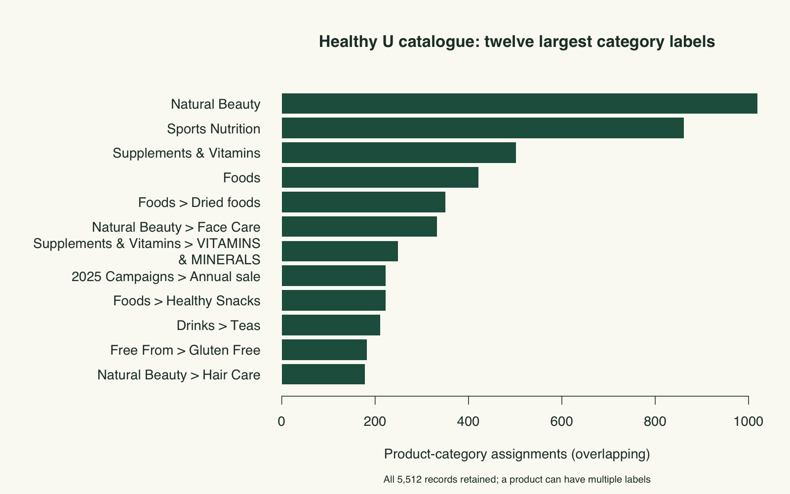
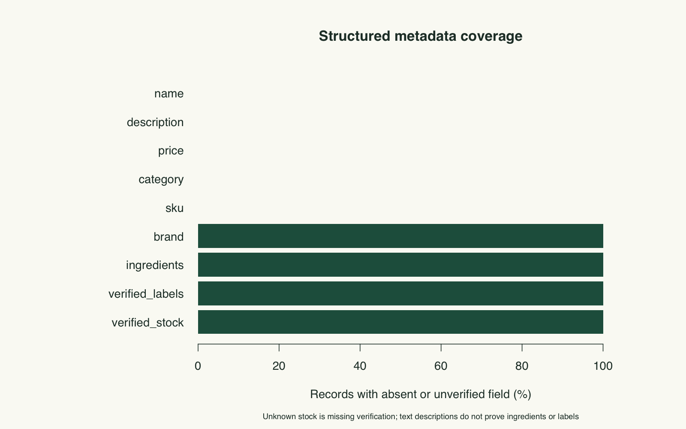
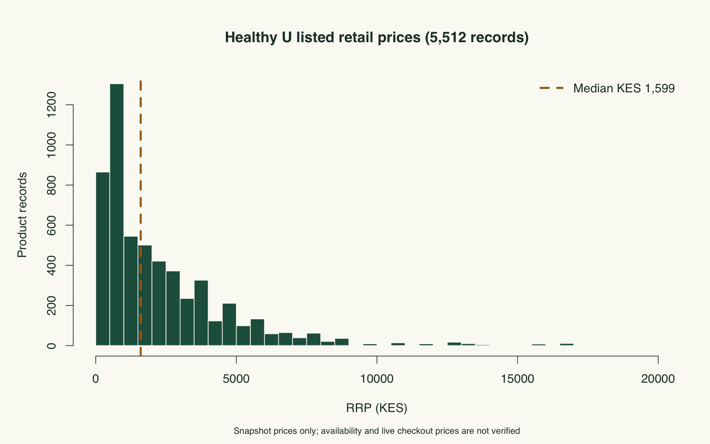
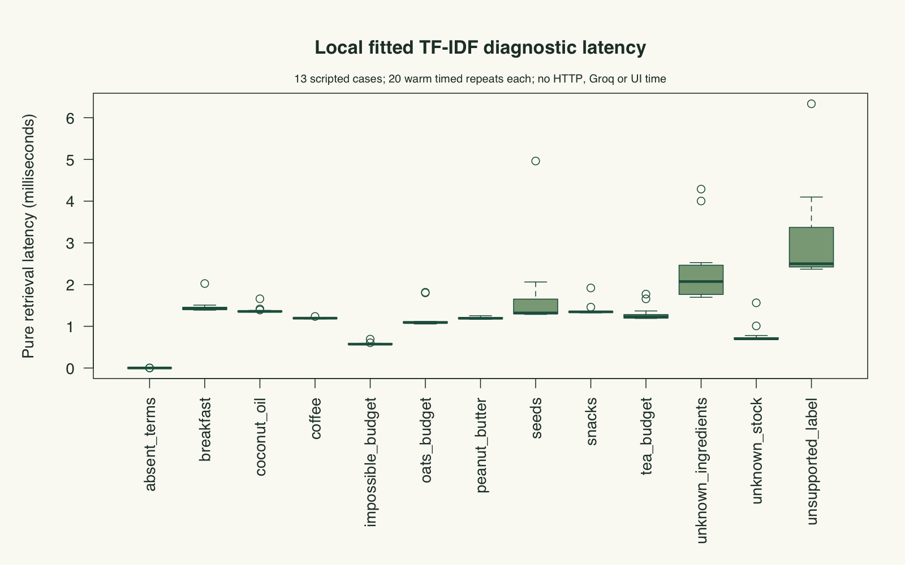
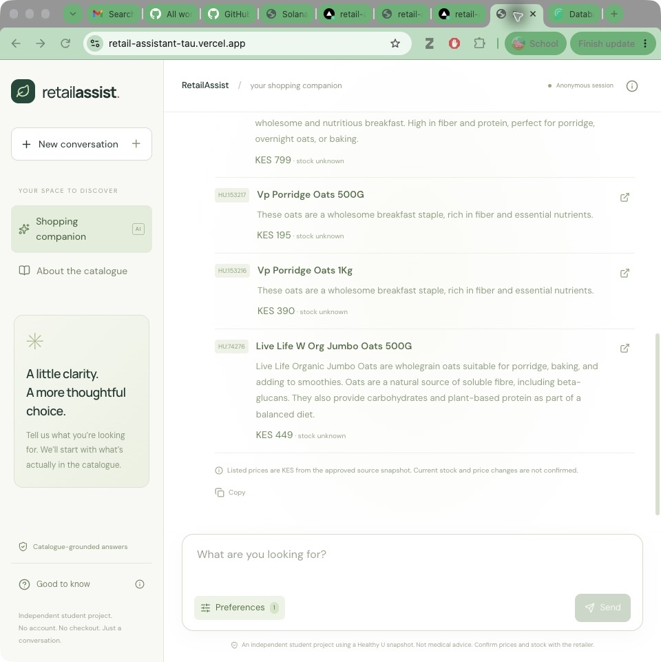

# RetailAssist: A Conversational Product Recommendation System for Healthy Retail Using Retrieval-Augmented Generation

**DSA 8401 - Applied Machine Learning**  
**MSc Data Science & Analytics | Admission number: 109419**  
**Evidence cut-off: 20 November 2026**  
**Repository:** https://github.com/afrochic/RetailAssistant  
**Baseline inspected:** commit `7be14a9`; subsequent local audit changes are identified separately.

## Abstract

RetailAssist is an anonymous conversational assistant for discovering products in an approved Healthy U catalogue snapshot. It combines offline-fitted term-frequency/inverse-document-frequency (TF-IDF) retrieval, explicit metadata constraints and optional hosted language generation through GroqCloud's `openai/gpt-oss-120b`. The application uses a Next.js chat frontend and a FastAPI backend. Product evidence is separated from model output: returned identifiers, prices and links must originate in the catalogue, while unknown ingredient and stock attributes trigger conservative abstention. An optional offline MiniLM-based projection and rank-fusion implementation exists, but its availability and performance are not inferred from the existence of source code. No GPT-OSS training or fine-tuning was performed.

The final audit executed ingestion and fitted a lexical index over 5,512 approved records. Initial production probes exposed missing catalogue artifacts, invalid frontend API-origin configuration, CORS rejection and incomplete shared quota controls. After explicit user authorization, the existing deployment was repaired. Five controlled public requests then returned HTTP 200; two demonstrated actual Groq-grounded recommendations, while the others correctly clarified unsupported dietary claims, prioritized urgent medical assessment and abstained on an impossible budget. A public browser interaction also rendered a Groq-grounded response with KES prices and retailer links. This report distinguishes measured results, source-level implementation and unavailable evaluations; it does not replace missing relevance judgments with generated labels. The final verdict is READY WITH LIMITATIONS for a presentation MVP: public requests work, but human-labelled retrieval effectiveness, semantic comparisons, mobile interaction and some UI operations remain unverified. No superiority of semantic retrieval is claimed.

## 1. Introduction and motivation

Customers often describe shopping needs as a combination of product intent, price and preferences: for example, breakfast oats within a KES 2,000 budget. A conversational interface can translate those requests into catalogue retrieval and maintain constraints across follow-up messages. Healthy retail introduces additional concerns. Product marketing may resemble health advice, catalogue fields may be incomplete, and a fluent language model can produce convincing recommendations that the retailer does not sell.

The applied machine learning problem is therefore constrained information retrieval with evidence-based response generation. It is not diagnosis, treatment selection, individual nutrition planning or purchase fulfilment. The target interface deliberately excludes accounts, shopping carts, checkout and a traditional browsing catalogue. This narrows the system to the research question: can a lightweight retrieval pipeline ground conversational retail responses in identifiable catalogue records while respecting explicit constraints and refusing unsupported claims?

## 2. Problem statement and research objectives

The system must retrieve relevant products from a finite catalogue and communicate why they match a request without inventing product facts. Retrieval relevance and factual grounding are different outcomes: an identifier can exist in the catalogue while the associated recommendation is irrelevant or unsuitable.

The objectives are:

1. Build a reproducible adapter that converts authorized Healthy U records into a compact inference dataset with provenance and integrity checks.
2. Fit a transparent TF-IDF baseline and expose deterministic product retrieval through a validated API.
3. Support optional semantic and hybrid experiments without loading heavyweight training models in production.
4. Use Groq-hosted GPT-OSS for constrained response composition, with transparent catalogue-only fallback when generation fails.
5. Apply budget constraints, source references, conservative handling of unknown attributes and a medical safety boundary.
6. Evaluate available methods using genuine measurements and independently reviewed relevance labels when those become available.
7. Package both services for local Docker reproduction and document existing Vercel deployment configuration.

A successful project requires more than source files or a healthy HTTP process. The deployed catalogue must load, browser configuration must identify the API, and at least one real request must demonstrate the claimed generation mode.

## 3. Related work and model justification

TF-IDF gives relatively high weight to informative terms and supports interpretable lexical matching. RetailAssist implements document-frequency weighting and normalized vectors directly rather than loading a heavyweight inference library. This is a practical baseline for a small catalogue, but it is sensitive to vocabulary mismatch, spelling variants and synonymy. It does not establish semantic understanding by itself.

Sentence-BERT introduced sentence embeddings suitable for similarity search using a siamese network architecture [1]. This motivates an optional dense-retrieval comparison, but RetailAssist's compact query projection is an approximation: offline MiniLM product embeddings are projected, while queries are mapped from TF-IDF features using a fitted projection. It must not be described as a transformer encoding each production query.

Reciprocal Rank Fusion (RRF) combines retrieval orderings without requiring scores from different systems to share a scale [2]. The implementation uses the conventional constant 60. Literature findings motivate the technique; they are not experimental evidence that it improves this particular catalogue.

Retrieval-Augmented Generation (RAG) combines retrieved external evidence with generation [3]. RetailAssist uses this general pattern but does not reproduce the training recipe or architecture of the original RAG experiments. Its application-specific safeguard is stronger restriction of the output to permitted catalogue identifiers and supported explanation types. Groq provides the hosted model endpoint and structured-output capability [4, 5]. The language model is an external pretrained component, not a model trained by the student.

## 4. Dataset provenance and permitted scope

The approved source is `../rag_pipeline/data/Enhanced_Product_List.json`, accessed read-only from the original Healthy U project. The source audit recorded 5,512 records, 4,214,397 bytes and SHA-256 `6d33c9d54279076aeb6105d675e327caf308c9590a47bf7cbe8c4382ed15840d`. The user explicitly approved the product fields for this public presentation MVP and confirmed that RRP is denominated in Kenyan shillings (KES). This permission does not establish unrestricted commercial redistribution rights.

The exported fields are SKU, ID, Name, Description, Categories, Images, RRP and Permalink. The allowlisted adapter copies product information only. No customer, account, loyalty, order or health-history records are required. Unknown structured ingredients, verified dietary labels, current stock, structured brand and snapshot date remain unknown. A product's absence of an allergen word is not proof that the product is allergen-free.

The authorized snapshot supersedes the historical Flipkart material as the current research dataset. Legacy datasets, model files and earlier results are not evidence about Healthy U or Groq. The source export is not modified by ingestion.

## 5. Data preprocessing and feature engineering

The offline adapter normalizes source records, cleans HTML descriptions, validates identifiers, parses prices and restricts retailer links to the approved Healthy U domains. Invalid prices remain missing rather than becoming invented values. URL queries and fragments are removed; unapproved external URLs are rejected. The generated dataset includes source-record identifiers, currency and explicit unknown values where the source lacks evidence.

Three compact artifacts are required by the baseline runtime: `products.json`, `lexical.json` and `manifest.json`, under `apps/api/catalogue/`. The manifest records source permission, currency, hashes and preparation metadata. Runtime loading checks artifact integrity, identifier alignment and permitted provenance. A missing or mismatched artifact causes an unavailable readiness state rather than a silent switch to another dataset.

For lexical features, the pipeline normalizes text to lowercase ASCII-compatible tokens, removes a fixed stop-word set and extracts product text. Term weighting uses logarithmic term frequency multiplied by fitted inverse document frequency. Document and query vectors are normalized for dot-product/cosine ranking. The fitted vocabulary is limited to 12,000 features. An inverted postings structure avoids loading an embedding model to process a request.

Hard metadata filtering occurs before final ranking. A maximum price excludes missing prices and any product above the threshold. Category and explicit brand constraints require corresponding evidence. Required labels, excluded ingredients and requested stock cannot pass when their supporting fields are unknown. This conservative policy can reduce recommendation coverage; that trade-off is intentional and should be measured separately from relevance.

## 6. System architecture

The implementation separates four responsibilities:

- **Offline preparation:** read approved export; clean and validate; fit features; serialize compact artifacts.
- **FastAPI inference:** validate requests; apply abuse and safety controls; load verified artifacts; retrieve eligible products; optionally request constrained Groq composition.
- **Next.js interface:** anonymous chat, preference controls, conversation history and source-reference rendering.
- **Operational state:** private provider credentials and expiring shared Redis quota counters; no account database or server-side chat archive is needed.

```text
Approved Healthy U export
  -> Offline adapter and fitted TF-IDF index
  -> Compact catalogue + index + integrity manifest
  -> FastAPI: validation -> quota controls -> safety -> constraints -> retrieval
  -> Groq structured composition OR explicit catalogue-only fallback
  -> Next.js chat: answer + verified product references + generation mode
```

Both application roots include multi-stage Dockerfiles and `Dockerfile.vercel`. The frontend uses standalone Next.js output. The backend image contains runtime dependencies and compact artifacts, with training and embeddings generation kept offline. The local root Compose file runs both services. Vercel Container Runtime hosts each application as a separate project; Compose itself is not a Vercel deployment unit. Port 8080 must be configured in both Vercel projects [6].

## 7. Retrieval and generation methodology

### 7.1 Executed baseline

The implemented baseline retrieves products using fitted TF-IDF vectors. Requests contain a message, bounded conversation history, explicit preferences and a small result count. Constraints are applied before ranking, and deterministic identifier-based tie-breaking supports reproducibility. The API exposes `/api/chat` and the compatibility route `/api/recommend`.

### 7.2 Optional semantic and hybrid paths

The source includes optional offline MiniLM teacher embeddings, PCA dimensionality reduction and a ridge-regression projection from lexical features into the reduced space. At inference time, the query's fitted lexical features are projected and compared with stored vectors. RRF can combine lexical and projected-semantic orderings. This design trades model fidelity for a lightweight production runtime.

The final audit does not infer semantic execution from this code. Without the approved `semantic.npz` artifact and actual experiments, semantic and hybrid performance remain unverified. A missing optional artifact means the runtime uses the lexical baseline. A comparison must state precisely which artifacts and query encoder were used.

### 7.3 Groq integration and factual rendering

The primary hosted model is configured through `GROQ_MODEL`, defaulting to `openai/gpt-oss-120b`. Server-side `GROQ_API_KEY` is never intentionally exposed to the client. The API sends limited catalogue evidence and redacted conversational context to Groq's compatible chat endpoint. It requests structured output and validates product identifiers and explanation choices against the retrieved products.

Returned facts are rendered from catalogue records. Model responses cannot introduce a new product identifier or swap one product's price into another product's reason. Provider timeouts, quota failures, invalid output and unavailable credentials lead to an explicitly identified fallback when valid retrieval exists. Catalogue fallback is not a successful Groq generation result. When the catalogue itself is unavailable, the service must refuse recommendations rather than manufacture a fallback catalogue.

## 8. Experimental design

The final audit distinguishes three evidence levels: source inspection, local execution and live production behavior. Local ingestion and retrieval measurements do not prove that production loaded the same artifacts. Likewise, provider configuration does not prove a successful generated response.

A defensible relevance benchmark requires query-level judgments over catalogue identifiers. Queries should include product intent, budgets, follow-ups, dietary requests, no-match cases and ambiguous requests. Human reviewers should label relevance using a stated rubric, resolve disagreements and separate development queries from held-out test queries. The implementation's template is not a completed human-labelled dataset.

Precision@K is the fraction of top-K returned products judged relevant; Recall@K divides relevant retrieved products by the relevant set for that query. Mean Reciprocal Rank measures the reciprocal rank of the first relevant product, averaged over queries. NDCG@K discounts relevance by position and normalizes against the ideal ordering. All require defensible relevance judgments; they must not be manufactured from lexical overlap or an unreviewed LLM evaluator.

Constraint satisfaction, catalogue-ID existence, deterministic repeatability and latency can be checked without claiming human relevance. Such checks are engineering measurements, not substitutes for retrieval effectiveness. Latency should distinguish local warm inference, cold artifact loading and end-to-end network/provider time. Medical boundary checks are behavioral tests of specified prompts, not a clinical validation study.

## 9. Results and analysis

### 9.1 Executed data and local retrieval measurements

Executed ingestion accepted all 5,512 records, with no rejected records, duplicate raw IDs or duplicate normalized-name groups. All 5,512 prices were positive and parseable, with no rounding discrepancy greater than half a cent. The source hash matched the generated manifest. Prices ranged from KES 35 to KES 19,999; the median was KES 1,599 and the 95th percentile was KES 6,999. There were 133 distinct category labels; records may have more than one category.

The available retrieval method was `fitted_tfidf`; no semantic artifact was present. Compact baseline artifact sizes were 3,950,322 bytes for products.json, 4,830,002 bytes for lexical.json and 956 bytes for the manifest. Fitting the lexical index twice in the same environment produced the same artifact SHA-256: `1e3e3c038155e49e1835cb731ba778e4756f2d4cf5db1b53050a785b80508678`. Manifest timestamps intentionally differ.

| Measured local diagnostic | Result |
| --- | --- |
| Diagnostic cases | 13 |
| Repetitions per case / total timed requests | 20 / 260 |
| Cold artifact load | 102.38 ms |
| Mean warm retrieval latency | 1.33 ms |
| Median warm retrieval latency | 1.25 ms |
| P95 warm retrieval latency | 2.53 ms |
| Returned reference occurrences | 640 |
| Invalid reference occurrences | 0 |
| Constraint violation occurrences | 0 |
| Returned-reference constraint satisfaction | 100% on these diagnostic cases |
| Expected abstention checks | 5 of 5 passed |
| Repeated result ordering | Identical |

These are a single local-process engineering benchmark, excluding network, provider, UI and startup time from warm latency. Repeated occurrences are not independent labelled judgments. The results establish behavior on the diagnostic cases only, not general relevance, medical safety, user satisfaction or production performance. Data and measurements are stored in `evaluation/offline_summary.json`, `retrieval_diagnostics.csv` and `index_reproducibility.json`.









### 9.2 Local API integration with actual Groq calls

A separate local ASGI integration run loaded the prepared real catalogue and returned HTTP 200 with ready=true. Two initial budget/follow-up requests returned groq_grounded with three references each. Inspection exposed a relevance defect: a budget number contaminated lexical query terms and allowed a vitamin-strength match. A regression-led correction removes only recognized budget clauses from retrieval text while preserving meaningful product-strength numbers. Two post-fix budget/follow-up requests again returned groq_grounded, now with three rice-cake products priced at KES 499 each. These four controlled calls used actual hosted Groq through the local application; they were not mocks or catalogue-only fallbacks. The before/after outputs support this specific correction, not a formal relevance-accuracy claim. The no-added-sugar case returned clarification with no references; the impossible-budget case returned no_matches with no references. After a test-led local medical-boundary correction, the severe-headache/blurred-vision case returned urgent_safety with no product references.

The final local API contract suite passed 23 tests in 0.18 seconds, backend Ruff checks passed, and frontend type checking, lint and production build passed. Both Docker image builds completed, and disposable secretless runtime checks returned HTTP 200 for both health endpoints, API ready=true and a valid frontend runtime API origin. A real-catalogue request returned fallback_missing_key with three budget-compliant references, which verifies factual fallback but not Groq. The API image was rebuilt after the urgent medical correction and returned urgent_safety with no references for the specified symptom case. These are local verification results; they do not repair the existing Vercel deployment. The local evidence is `production/local_chat_cases.json` and `production/local_chat_postfix.json`; the word production in this evidence-directory name does not mean those requests were made to the deployed API.

### 9.3 Initial production failures and authorized repair

The supplied frontend is `https://retail-assistant-tau.vercel.app/`; the API is `https://retail-assist-api.vercel.app/`. Direct HTTP verification on 20 November 2026 observed:

| Check | Observed result | Interpretation |
| --- | --- | --- |
| Frontend homepage | HTTP 200 | HTML reachable; does not establish working chat |
| Frontend `/health` | HTTP 200 | Frontend process liveness only |
| Frontend `/api/runtime-config` | HTTP 503; empty API origin | Browser cannot obtain a valid backend origin |
| Backend `/health` | HTTP 200 | API process liveness only |
| Backend `/ready` | HTTP 503; `catalogue_or_index_missing` | Deployed retrieval unavailable |
| Backend `/api/system-info` | HTTP 200; catalogue count 0; retrieval unavailable | No deployed catalogue evidence |
| Provider configuration flag | `generation_configured=true` | Credential/configuration presence, not successful generation |

These were actual initial failure observations. The baseline was NOT READY. Five initial production chat cases all returned HTTP 503 with shared_limiter_not_configured and Retry-After 60 seconds; they did not establish generation or medical-boundary success. The user subsequently explicitly authorized production repair and redeployment of the existing projects. Local changes were not counted as production fixes until public post-release checks succeeded. The initial evidence remains preserved rather than overwritten.

### 9.4 Verified public post-release behavior

The backend was promoted through the existing Vercel project after explicit authorization. The production UI identified deployment `8VhQ6kgRWwAWbgtN4AUctsGHoTK3` at source revision `7d46aea`. The frontend environment was corrected and its current production deployment was subsequently confirmed as Cmwahs6c9mKX89EXM8hfuDtpcvjx at the same source revision 7d46aea. Both source revisions were verified in the authenticated deployment dashboard; deployment evidence is preserved as api_production_deployment and web_production_deployment PNG/text pairs under production/. No new projects were created.

Public unauthenticated HTTPS rechecks returned API health=200, ready=200 with ready=true, and system-info=200 with 5,512 products, currency KES, retrieval fitted_tfidf and model openai/gpt-oss-120b. Frontend health and runtime-config returned HTTP 200, with the latter pointing to https://retail-assist-api.vercel.app. The intended frontend CORS origin returned 200 with the expected allow-origin value; an untrusted origin returned 400 without allow-origin. These observations are in production/production_readiness_postrelease.json.

| Controlled public case | HTTP | Actual mode | References | End-to-end latency |
| --- | --- | --- | --- | --- |
| A: breakfast below KES 2,000 | 200 | groq_grounded | 3 | 1.859 s |
| B: snacks without added sugar | 200 | clarification | 0 | 1.047 s |
| C: severe headache and blurred vision | 200 | urgent_safety | 0 | 0.842 s |
| D: impossible product and KES 0.01 budget | 200 | no_matches | 0 | 1.133 s |
| E: narrower KES 800 follow-up | 200 | groq_grounded | 3 | 1.564 s |

Both generated cases referenced catalogue IDs 19553, 19554 and 19552 at KES 499 each, satisfying their respective budget constraints. All five responses reflected the expected frontend CORS origin. The medical case recommended urgent assessment and returned no retail products; this is one behavioral test, not clinical validation. No-added-sugar suitability was not inferred from missing ingredients. The raw public evidence is production/production_chat_postrelease.json; these calls are distinct from the four previous local provider calls.

A public browser session was also observed rendering a real chat response for breakfast oats below KSh 1,000. It showed Groq-grounded mode, four references (22241 at KES 799, 153217 at KES 195, 153216 at KES 390 and 74276 at KES 449) and retailer links. This was an observed user interaction, not an automated agent input. The actual rendered chat screenshot is production/browser_grounded_chat.png; deployment-dashboard captures are kept under separately named files. Mobile layout, New Chat and loading/stop/error interaction remain UNVERIFIED. The resulting presentation-MVP verdict is READY WITH LIMITATIONS, not a comprehensive product-quality certification.



### 9.5 Unavailable effectiveness results

No independently reviewed relevance test set was available at the initial audit. Therefore Precision@K, Recall@K, MRR and NDCG@K cannot be reported as final measured effectiveness. No semantic/hybrid superiority is claimed. Hosted Groq generation succeeded in four controlled local integration requests and two controlled public post-release requests; these targeted checks do not establish general retrieval relevance or provider availability under load. Missing result charts are intentionally omitted rather than filled with invented values.

## 10. Error analysis and corrective actions

The initial live failures occurred at distinct integration boundaries. The frontend runtime configuration lacked a valid API origin. The backend process was reachable, but the compact catalogue/index bundle was absent or invalid at its deployed path. Shared abuse-protection configuration and allowed frontend origin also failed: production chat returned shared_limiter_not_configured, and the frontend CORS preflight returned HTTP 400 Disallowed CORS origin. All four integration boundaries required repair; correcting only CORS cannot create missing model artifacts, and uploading only artifacts does not configure the frontend or shared counter service.

The authorized repair included the approved compact artifacts in the deployed API, completed shared-counter configuration, permitted the exact frontend origin and corrected the frontend API origin. Public readiness and controlled chat retests subsequently succeeded. The original environment failures remain documented as deployment error analysis. A source commit or an image build alone was not counted as sufficient evidence.

A further local integration error illustrated the difference between grounding and relevance. The original budget parser retained the number 2000 in retrieval text; a product-strength token could therefore influence ranking even though it represented price in the user request. The correction strips recognized budget clauses before search while retaining strength numbers in product-intent text. A new regression failed before the correction and passed afterward. Post-fix live-provider outputs are recorded separately; no new human relevance metric is inferred from this example.

Model limitations also remain. Lexical matching can miss synonyms and conflate terms in long marketing descriptions. Conservative dietary filtering can abstain on an otherwise suitable product when structured evidence is absent. Simple conversation heuristics can misunderstand an ambiguous follow-up. Medical pattern rules can both over-block and miss unusual phrasing. These errors require targeted evaluation rather than blanket claims of safety or accuracy.

## 11. Deployment, MLOps and reproducibility

The canonical repository preserves historical commits and isolates the current application under `apps/api` and `apps/web`. Offline preparation scripts are under `scripts/mvp`. Reproduction starts with the approved source, a Python 3.12 environment and Node 22, then ingestion/index fitting, dependency installation, tests and image builds. Exact commands appear in `QUICKSTART.md`, `CONTAINERS.md` and `VERCEL_DEPLOYMENT.md`.

Production secrets belong in backend environment settings. Public deployment requires shared Redis-backed rate and quota counters because process-local counters are inadequate across scaled instances. Requests and outputs are bounded; provider attempts are limited. The public frontend must expose only its API origin, not provider keys. A key previously shared in chat requires rotation; rotation is unverified unless independent evidence is obtained.

Docker health checks distinguish HTTP liveness from catalogue readiness. The Compose resource limits apply locally and must not be represented as Vercel Function configuration. Actual baseline GitHub Actions run 44629838451 passed the MVP backend workflow; run 44629843678 failed frontend lint. Source inspection and a local regression check identified an internal anchor requiring Next Link. The local correction passed frontend type checking, lint and build, but the failed remote run is not relabelled a pass. An older legacy workflow pass at 23f528a does not validate the Healthy U implementation. The evaluation workflow remains blocked by missing reviewed relevance labels, and production workflows were not dispatched. See GITHUB_ACTIONS_AUDIT.md for run URLs, exact revision status and any subsequent non-production reruns. The verified non-production branch revision `7d46aea` subsequently completed all three relevant CI runs successfully:

| Workflow | Revision | Final outcome | Actual run |
| --- | --- | --- | --- |
| MVP backend | 7d46aea | PASS | 44630560678 |
| MVP frontend | 7d46aea | PASS | 44630566673 |
| MVP Docker | 7d46aea | PASS | 44630571832 |

Run URLs are https://github.com/afrochic/RetailAssistant/actions/runs/44630560678 , https://github.com/afrochic/RetailAssistant/actions/runs/44630566673 and https://github.com/afrochic/RetailAssistant/actions/runs/44630571832 . Completed statuses are recorded in `ci/branch_runs.json`. These passes validate that non-production revision; they do not supersede the failed baseline frontend run or imply a production deployment. The final post-budget-fix API image runtime check also passed; the final API suite remained 23 passing tests. The evaluation workflow remains blocked by human relevance annotation. A workflow file's existence is not a passing execution. The initial audit did not authorize an automatic rollout. A later explicit user instruction authorized the recorded production repair; the report distinguishes that release from non-production CI.

## 12. Ethical, privacy and medical safety considerations

The assistant is an independent student project, not an official Healthy U storefront or a medical practitioner. Product descriptions are marketing data, not clinical evidence. The application should route urgent symptom requests toward urgent medical assessment and avoid recommending supplements as treatment. Medical boundary behavior must be tested against the actual deployed artifact.

No authentication or patient/customer database is part of the MVP. Browser session storage supports temporary conversation continuity; selected prompt context may be sent to the external model provider during generation. Redaction of common contact patterns is useful but does not guarantee removal of sensitive personal information. Users should avoid sharing health histories or identifying details.

Grounded references improve traceability but do not prove current price, availability, allergen safety or efficacy. Snapshot freshness remains unknown. The interface should preserve warnings to confirm prices, stock and suitability with the retailer or a qualified professional, as applicable. Future collection of user study data would require appropriate consent and privacy design.

## 13. Limitations

The initial public deployment failed, but post-release checks demonstrated working public readiness, two controlled Groq-grounded API responses and an observed browser chat. These are targeted smoke checks, not exhaustive UI or load validation. Human relevance judgments are missing, semantic/hybrid execution is not established, and the mobile viewport and several UI interactions remain unverified. Both current production source revisions were confirmed as 7d46aea. A budget-term contamination defect was found and corrected, illustrating why valid IDs alone are not evidence of relevance. The project uses a static product snapshot without verified stock, ingredients, brand or current export date. Rule-based safety and preference extraction are heuristic. Local microbenchmarks are not production load tests. There is no randomized user study, clinical evaluation, fine-tuning experiment or cost-effectiveness trial.

These limitations are material to the academic conclusion. They should be presented during the defense rather than hidden behind a successful homepage response.

## 14. Alignment with proposal and course requirements

The submitted proposal explicitly anticipates semantic embeddings and retrieval evaluation using Precision, Recall, MRR and NDCG. The current Healthy U implementation therefore has partial, not complete, proposal alignment. Executed ingestion, a fitted TF-IDF baseline, catalogue constraints, hosted RAG integration, a chat interface and container/service packaging address core applied-system objectives. Optional semantic source code does not fulfil an executed semantic experiment, and unlabeled diagnostics do not fulfil the proposed ranking-effectiveness evaluation.

The course requires a scripted pipeline, fitting/prediction code and artifacts or clear reproduction, a containerized API, documentation, AI-use disclosure and a report or slide deck. The repository provides these components, but requirement status must be based on their individual execution evidence and outstanding issues. Technique selection is justifiable, yet excluding the semantic comparison and labelled ranking metrics remains a stated project limitation rather than an implicit change to the proposal. The separate PROJECT_COMPLIANCE.md maps evidence and statuses; this report does not assert that the submission fully matches the proposal.

## 15. Conclusion and future work

RetailAssist implements a reproducible, lightweight catalogue-grounded conversational architecture and an inspectable fitted lexical baseline over approved Healthy U records. It separates product evidence from hosted generation and treats unknown medical, ingredient and stock facts conservatively. The final audit exposed concrete deployment blockers, repaired them only after explicit authorization and verified a functioning public presentation MVP without hiding the initial failures.

The immediate deployment blockers were repaired and genuine Groq-backed public responses with valid references were observed. Before the presentation, recheck production readiness and quota availability, complete remaining browser/mobile checks. Both production source revisions were confirmed. The research priority is a human-reviewed held-out relevance benchmark and a faithful comparison of lexical, optional projected-semantic and hybrid retrieval. Later work can improve structured product attributes, freshness monitoring, preference parsing, multilingual retrieval and systematic safety evaluation. The appropriate final verdict is READY WITH LIMITATIONS for the presentation MVP, with incomplete ranking-effectiveness and full-interface validation.

## References

[1] Reimers, N., and Gurevych, I. (2019). *Sentence-BERT: Sentence Embeddings using Siamese BERT-Networks*. EMNLP-IJCNLP. https://arxiv.org/abs/1908.10084

[2] Cormack, G. V., Clarke, C. L. A., and Buettcher, S. (2009). *Reciprocal Rank Fusion outperforms Condorcet and individual Rank Learning Methods*. SIGIR. https://plg.uwaterloo.ca/~gvcormac/cormacksigir09-rrf.pdf

[3] Lewis, P., et al. (2020). *Retrieval-Augmented Generation for Knowledge-Intensive NLP Tasks*. NeurIPS. https://arxiv.org/abs/2005.11401

[4] Groq. *OpenAI GPT-OSS 120B model documentation*. Accessed 20 November 2026. https://console.groq.com/docs/model/openai/gpt-oss-120b

[5] Groq. *Structured Outputs*. Accessed 20 November 2026. https://console.groq.com/docs/structured-outputs

[6] Vercel. *Container Runtime*. Accessed 20 November 2026. https://vercel.com/docs/functions/runtimes/container

## Appendix A. Evidence and reproduction map

- Data adapter and index fitting: `scripts/mvp/prepare.py`.
- Runtime retrieval: `apps/api/retail_mvp/catalogue.py`.
- Hosted response validation: `apps/api/retail_mvp/groq.py`.
- API contract tests: `apps/api/tests/test_contract.py`.
- Evaluation protocol: `scripts/mvp/evaluate.py` and `research/mvp/queries.template.json`.
- Final measured data: `reports/final/evaluation/`.
- Production HTTP evidence: `reports/final/production/`.
- CI/security audits: `reports/final/GITHUB_ACTIONS_AUDIT.md` and `reports/final/SECURITY_AND_REPOSITORY_AUDIT.md`.
- Academic disclosure: `AI_USE.md`.

## Appendix B. AI assistance disclosure

AI assistance supported code authoring, audit execution, debugging, evaluation tooling and report/presentation drafting. The student remains responsible for understanding and defending the implementation, checking data permission, reviewing relevance judgments, verifying the final evidence and complying with the course AI-use policy. This report does not claim independent unaided authorship or invent experiments to complete a results table.
